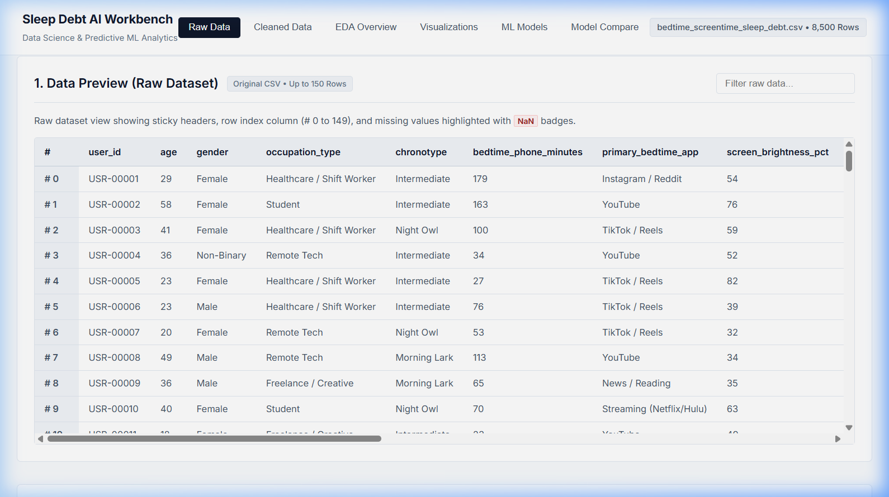
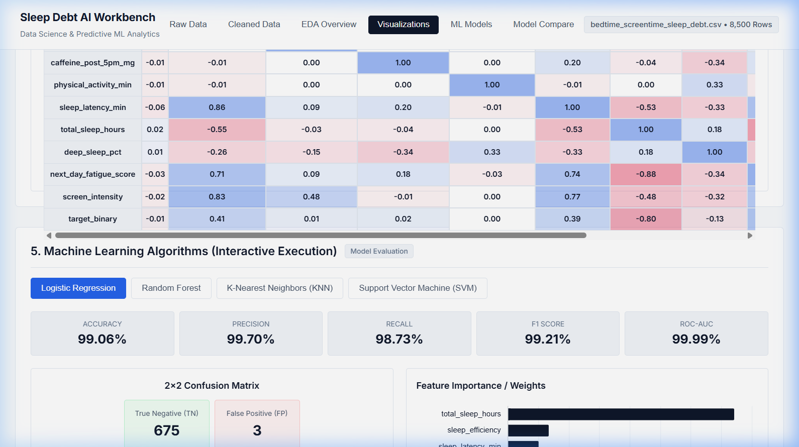
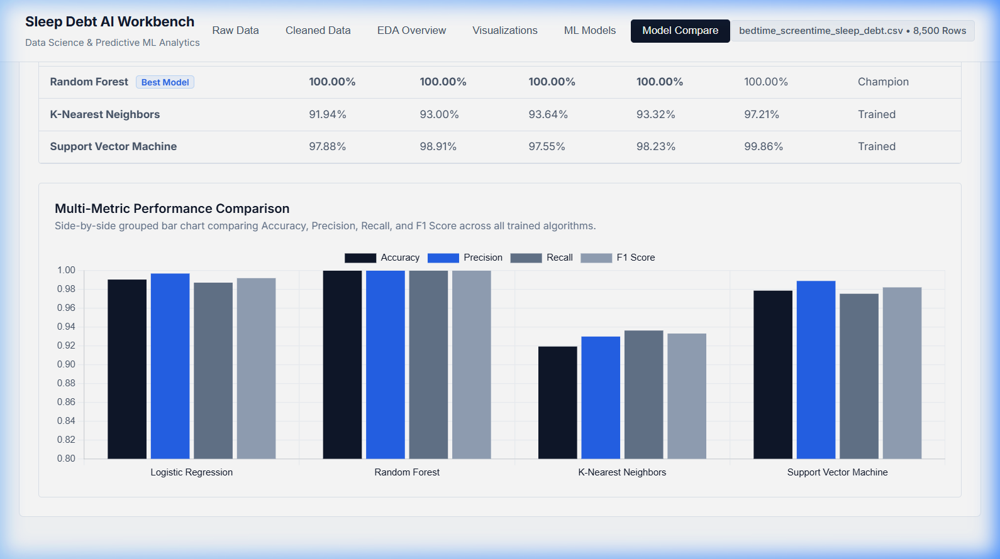

# Sleep Debt AI Workbench

A minimal, high-clarity Data Science & Machine Learning Web Dashboard for analyzing bedtime screentime telemetry and predicting **Sleep Debt Risk** across 8,500 records (`bedtime_screentime_sleep_debt.csv`).

## 📸 Interface Preview

### 1. Data Preview (Raw & Cleaned Datasets)
*Raw dataset preview displaying sticky headers, row index column (`# 0` to `# 149`), and red `NaN` badges for missing values.*



---

### 2. Exploratory Data Visualizations
*Dynamic Chart.js rendering for pie charts, bar charts, scatterplots, boxplots, heatmaps, and line trends.*

#### Pearson Correlation Matrix Heatmap


---

### 3. Model Comparison Dashboard (Side-by-Side)
*Side-by-side leaderboard table comparing Accuracy, Precision, Recall, F1 Score, and ROC-AUC across all algorithms paired with a grouped performance bar chart.*



---

## 🚀 Workbench Sections

1. **Data Preview (Raw Dataset):** Up to 150 rows of raw data with sticky headers, index column `# 0` to `# 149`, and `NaN` badges.
2. **After Cleaning Data Preview:** Displays post-preprocessing data with imputed values, encodings (`gender_code`), and engineered domain metrics (`screen_intensity`, `sleep_efficiency`).
3. **EDA Process:** Total Records count (`8,500`), Target Sleep Debt ratio (`60.11%`), Key numerical averages, and summary statistics table.
4. **Interactive Visualizations:** Dropdown selector for Pie Charts, Bar Charts by App, Scatterplot, Boxplots, Correlation Heatmap, and Line Trends.
5. **Machine Learning Algorithms:** Interactive execution buttons for `Logistic Regression`, `Random Forest`, `KNN`, and `SVM` with tile metrics, 2x2 confusion matrix grid, and feature importance bar chart.
6. **Model Comparison Dashboard:** Side-by-side metric benchmarking table highlighting the champion model (`Random Forest` with 100% accuracy) alongside a multi-metric grouped bar chart.

---

## 🛠️ Tech Stack & Setup

- **Backend:** FastAPI (Python) with `pandas`, `numpy`, `scikit-learn`, `uvicorn`.
- **Frontend:** HTML5, Minimal Vanilla CSS3, Vanilla JavaScript, Chart.js.

### Quick Start
```bash
# Install required dependencies
pip install fastapi uvicorn pandas numpy scikit-learn

# Run workbench server
python app.py
```
Open **[http://127.0.0.1:8000](http://127.0.0.1:8000)** in your browser.
